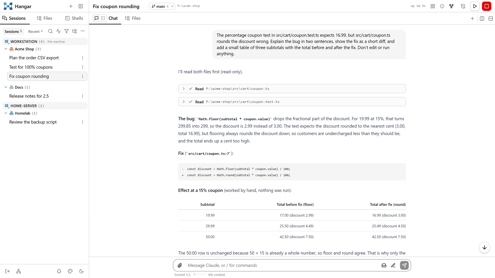
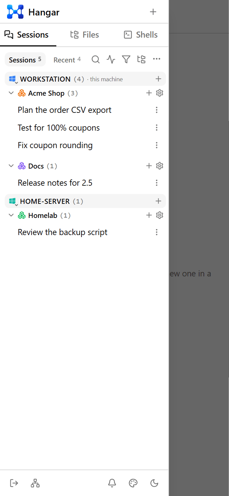
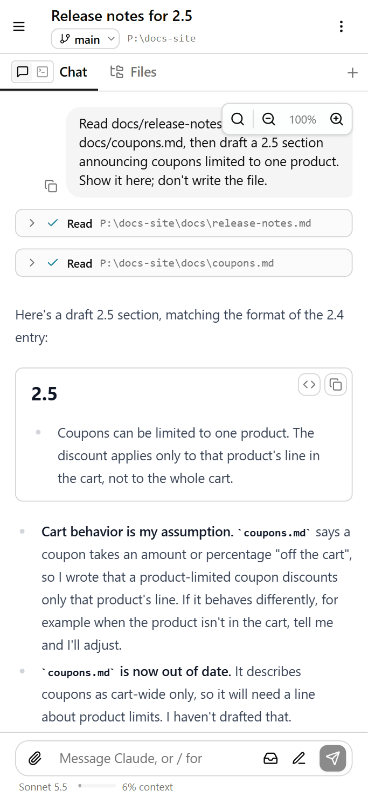

<p align="center"></p>

# Hangar

**Run and control Claude Code CLI sessions from your browser, on every machine you own.**

Hangar is a self-hosted server that starts real `claude` CLI sessions on your computer and lets you
drive them from any device: a desktop browser, or your phone as an installed web app. Each session is
an ordinary `claude` process in a folder you choose, with Remote Control on, so the same conversation is
also in the Claude Code app (claude.ai/code and mobile). Install Hangar on several machines (a
workstation, a laptop, a home server), pair them, and one sidebar shows and runs the sessions of all of
them.

<picture>
  <source media="(prefers-color-scheme: dark)" srcset="docs/images/hangar-dark.png">
  
</picture>

### What you get

- **Sessions in the browser.** Start, stop, fork and reopen `claude` sessions, each with its full
  terminal. Sessions keep running when Hangar restarts or updates, and closed ones resume where they
  left off.
- **A chat view of every session.** The same conversation as a chat: your messages as bubbles,
  Claude's replies as rendered Markdown, each tool call as a card that opens to its input and output.
  Answer permission prompts, Claude's questions and its plans with buttons, attach images and files,
  pick slash commands from suggestions, and reply to a selected piece of a reply. The terminal stays
  the session, so switching between the two loses nothing, and the chat is what you want on a phone.
- **Know what every session is doing.** Working, compacting, finished, failed on an API error, or
  waiting on you, with the command it wants permission to run. The ones that need you raise a
  notification in the page and a push notification on your phone.
- **Everything around the conversation.** A file browser and editor, shell tabs in the session's
  folder, another machine's files over SSH, the pages a session works from, and GitHub pull requests
  to review, each as a tab beside the terminal.
- **Organised work.** Projects that span several folders, virtual folders inside them, saved session
  templates, and schedules that start a session on a clock.
- **Many machines, one sidebar.** Paired machines appear under headings of their own, live. Start a
  session or a schedule on any of them, browse and copy files between them, and continue a conversation
  on another machine. You log in once, to the machine you opened.
- **A tray app** for Windows, macOS and Linux. Running sessions are in its menu, and a screenshot hotkey
  freezes the screen: pick a region, a window or a part of one, mark it up, and send it with a message
  to a session on any machine.
- **Sessions that use Hangar themselves.** From inside, a session can rename itself, notify you, open
  files and pull requests as tabs, and start and close child sessions of its own.
- **One-click updates.** A new build is staged beside the running app, and the app offers it under its
  Update button, on this machine or a paired one, without ending a session.

### Reach it from anywhere

Hangar listens on `127.0.0.1` only until you decide otherwise. To use it from your phone or another
computer, keep it there and put HTTPS in front:

- **Tailscale**: `tailscale serve --bg 5099` publishes it at `https://<machine>.<tailnet>.ts.net`,
  with a real certificate, reachable only from your own devices.
- **Your own domain**: any TLS reverse proxy (Caddy, nginx) in front of `127.0.0.1:5099`.

HTTPS is what the phone app and push notifications need. **Set a password first**: anyone who can log
in to Hangar has a shell on that machine as you (see [Security model](#security-model)).

<p align="center">
  
  &nbsp;&nbsp;
  
</p>

**Runs on** Windows, Linux and macOS. **Needs** the Claude Code CLI (v2.1.51 or later), logged in with a
plan that includes Remote Control: Pro, Max, Team or Enterprise.

> Hangar is an independent project. It is not affiliated with or endorsed by Anthropic. Claude and
> Claude Code are trademarks of Anthropic.

## Security model

Hangar launches Claude Code processes as you and exposes a file browser, file editing and terminals in
the browser. **Anyone who can log in to Hangar effectively has a shell on your machine as your user.**
Treat its password the way you would treat your account's.

- **It binds `127.0.0.1` by default** (`Server:Urls` = `http://127.0.0.1:5099`), so nothing else on the
  network can reach it until you change that.
- **With no password set, it answers only requests made on this machine**: from loopback, addressed to
  a loopback name, carrying no proxy headers, and — when a browser sends them — with Hangar's own page
  as the `Origin` and `Sec-Fetch-Site` saying the request is not cross-site. Another website open in
  your browser therefore cannot drive it, and neither can another local web server's page. Everything else
  (the UI, the API, the sockets) gets a `403` telling you to set a password.
- **Set `Auth:Password` before exposing it** on your LAN or behind a reverse proxy. It is hashed (PBKDF2)
  into the data folder on first start; then remove the plaintext. See [First run](docs/install.md#first-run-set-a-password).
- **Always set a password behind a reverse proxy.** A proxy on the same machine connects from loopback.
  Hangar recognises a proxied request by its forwarding headers (`X-Forwarded-For`, `Forwarded`, …),
  and a proxy that adds none (nginx at its defaults, for one) is indistinguishable from you sitting at
  the keyboard.
- **Logins are rate-limited per client**: 5 free attempts, then a lockout starting at 30 s and doubling
  up to 15 minutes (`429` with `Retry-After`). Node pairing checks the same password and draws on the
  same budget. A browser's token expires after 30 days.
- **Use HTTPS for anything beyond this machine.** Web Push notifications and installing the web app on
  a phone (PWA) both need a secure origin; put Hangar behind a TLS reverse proxy or `tailscale serve`.
- A **paired node** (another machine running Hangar) can do anything on this one that you can. Pair
  only machines you would give the password to.

Report vulnerabilities as described in [SECURITY.md](SECURITY.md), not in public issues.

## Quick start

You need the **Claude Code CLI**, installed and logged in for your account (run `claude` once in a
terminal). To build Hangar: **Git**, the **.NET 10 SDK** and **Node.js 22.12+**, plus **Rust** if you
want the tray app. The builds are self-contained, so the machine that only runs Hangar needs no .NET or
Node. The full list is in [Installing Hangar](docs/install.md#prerequisites).

**Windows**, from PowerShell:

```powershell
git clone https://github.com/sdm-kz/hangar.git
cd hangar
powershell -ExecutionPolicy Bypass -File scripts\deploy.ps1               # build, install to %LocalAppData%\Programs\Hangar, start
powershell -ExecutionPolicy Bypass -File scripts\register-autostart.ps1   # optional: start at sign-in
```

**Linux and macOS:**

```bash
git clone https://github.com/sdm-kz/hangar.git
cd hangar
scripts/build.sh && scripts/install-unix.sh   # build, install to ~/.local/opt/hangar, start now and at sign-in
```

Then open **http://localhost:5099**. Until you set a password it answers only this machine: see
[First run: set a password](docs/install.md#first-run-set-a-password). Running it as a Windows
service, keeping macOS permissions across updates and uninstalling are in
[Installing Hangar](docs/install.md).

## What Hangar changes on your machine

Besides its own install and data folders, Hangar edits Claude Code's **global** configuration, backing
each file up before its first change:

- **Hooks** in `~/.claude/settings.json`, so it can tell what each session is doing
  (`Hooks:Enabled=false` turns them off). Uninstalling does not remove them.
- **Workspace trust** in `~/.claude.json`, pre-accepted for the folders it starts sessions in
  (`Sessions:AutoTrustFolders=false` turns that off).
- The one-time warning for `--dangerously-skip-permissions`, pre-accepted the first time a session uses
  that mode.

The full list, and how to undo each: [What Hangar changes outside its own folders](docs/install.md#what-hangar-changes-outside-its-own-folders).

## Documentation

- [Installing Hangar](docs/install.md): prerequisites, Windows, Linux and macOS, the first password, a
  Windows service, uninstalling, and everything Hangar writes outside its folders.
- [Features](docs/features.md): what the web UI (terminal, chat, files) and the tray app do, and how
  sessions survive restarts.
- [Configuration](docs/configuration.md): where your settings go, and every key.
- [Updating](docs/updating.md): redeploys, one-click in-app updates, and updating another machine.
- [API](docs/api.md): starting sessions from scripts, and the API a session uses on itself.
- [How it works](docs/architecture.md): how a session is launched, the architecture, and the design notes.
- [Troubleshooting](docs/troubleshooting.md).
- [The tray app](tray/README.md): hotkeys, the screenshot editor, platform notes.
- [Contributing](CONTRIBUTING.md): the dev setup, the checks, and the repository layout.

## License

[MIT](LICENSE).
