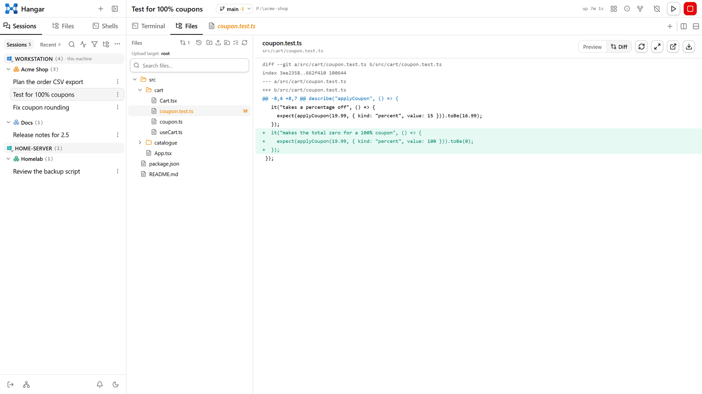

[← Hangar](../README.md)

# Features

<picture>
  <source media="(prefers-color-scheme: dark)" srcset="images/files-diff-dark.png">
  
</picture>

Hangar is two programs:

- **`Hangar` (`Hangar.exe`) — the server.** A headless daemon that owns everything: the sessions, the
  web UI and its API, every store. It starts at sign-in as you — or, when it has to run while nobody is
  signed in, as a Windows service under your account — and there is one per port: launching it again
  just opens the UI.
- **`Hangar.Tray` — the tray app** (`tray/`), for Windows, macOS and Linux. Optional, and a client of
  the server's API, nothing more:
  - **Left-click** (Windows) opens the web UI in your browser. On macOS and Linux a click opens the
    menu, which starts with **Open Hangar**.
  - **Sessions** in the menu lists the running sessions. Each project is a submenu, and inside it the
    sessions are laid out the way the sidebar's grouped view lays them out with its active-only filter
    on: virtual folders first, then folder groups (dropped where the project links only that folder
    and there is no virtual folder to tell it apart from), forks under the session they came from, and
    no submenu for a project with nothing running in it. Below them, **Recent** (closed sessions) and a
    submenu per paired machine. Click a session to open it.
  - **Screenshots.** A hotkey freezes the screen; you pick a region, window, screen or freeform shape,
    mark it up, type a message, and send both to one of the server's running sessions — the picture
    lands in the prompt as a pasted image would.
  - **Quit** closes the app; **Stop server…** stops the server. Neither ends a session (see
    [Sessions survive an app restart](#session-lifecycle)). The icon greys out while the server isn't
    running, and the menu then offers **Start server**. Both server items are there only for a server
    on the same machine: the app can follow a server anywhere it can reach (Settings → *Hangar address*).

  See [tray/README.md](../tray/README.md).

The web UI is a **session manager with a full terminal**:

- **Create / select sessions** — each session is a live `claude --remote-control` process in a
  working folder of your choice.
- **Control from the Claude Code app** — launched sessions register for Remote Control and appear
  by name in the app's session list (computer icon + green dot), so you can carry on from there.
- **Chat view** — the chat icon in Claude's tab (next to the terminal one) shows the same
  session as a chat: your messages as bubbles, Claude's replies rendered as Markdown, each tool call as
  a card that opens to its input and output. A ```` ```markdown ```` block in a reply (a drafted ticket or PR
  description) is shown rendered in a frame, with a switch to its source and a button that copies it. It is read from the transcript Claude writes as it goes
  (`~/.claude/projects/…/<conversation>.jsonl`), and what you write goes into the terminal the way
  typing it there would, so the terminal stays the session and switching loses nothing. A turn can be
  stopped from the chat, a tool permission answered with **Allow** / **Deny**, and a question Claude asks
  (AskUserQuestion) answered in a form — pick options or type your own, and the choices are typed into
  its dialog in the terminal. A message sent while Claude is working waits in Claude's queue, as one
  typed in the terminal does: the chat shows it as a dashed "Queued" bubble until Claude takes it —
  after the turn, or between two of its steps, when it is marked "Sent while Claude was working".
  Anything else that only
  the terminal can show — a picker, a plan to approve, `/usage` — is one click away. The choice is kept
  per session and per browser, so a phone can read the chat while the desk keeps the terminal; it is
  also kept with the session itself, so a stopped session reopens on the view it was left on (here and
  after the app restarts), and a browser that has made no choice of its own opens it that way too. The
  **New session** dialog has a Chat / Terminal switch for the view the new session opens on, which starts
  where the last session started from that browser did. The
  postponed-messages and compose buttons move from the terminal's corner into the chat's message box
  (Ctrl/⌘+Shift+Enter there postpones what is written, and the send button turns into Postpone while the
  chord is held; Compose carries on what is written there),
  which has its own image button. Typing `/` there suggests slash commands — Claude's own, yours, the
  project's, plugins' and skills' — with their descriptions: arrows to choose, Tab or Enter to take one,
  Enter again to run it. It works anywhere in the text (a word that starts with `/`, at the caret), and
  in the postponed pool's box and the full-size composer too, and every command in the text that Claude
  knows is tinted, so a typo'd one stands out before it is sent. A command that answers in the terminal (`/model`, `/config`, `/context`…)
  switches to it when sent. Under the box: the model and how full the context window is. That comes
  from a status line Hangar gives each session it launches (`--settings`, so `~/.claude/settings.json`
  is untouched, and only when neither you nor the project has a status line of your own) — the terminal shows it too, as
  "Opus 5.5 · 24% context". A session started before that shows its tokens in context instead of the
  percentage, until it is restarted. The chat zooms on its own, like the terminal: the buttons in its corner,
  Ctrl/⌘ with + − 0, or Ctrl/⌘-wheel; the size is shared by every session's chat and remembered.
- **Fork a session** — branch a conversation in two from the sessions list or the session header:
  name the fork, and it launches beside the original with the same folder and settings, picking up
  its history (`claude --resume <id> --fork-session`). The original keeps running, untouched. Forks
  nest under their parent in the sessions list, and each one's header links back to it.
- **Projects** — name a project, give it a colour, and link the folders it spans (any number,
  unrelated to each other). Projects head both session views: grouped, the folder groups sit under
  their project; flat, the sessions themselves do, with no folder headings in between. A project
  that is just one folder drops the folder heading in the grouped view too — its sessions hang
  straight off the project, since the two headings would say the same thing. Anything unfiled
  follows under *No project*. A linked folder covers everything **under** it too, so a new
  worktree or nested repo — and any session started there — joins by itself. Drag a folder group
  onto a project to move it (or onto *No project* to take it out), or use the folder's ⋯ menu. The
  **+** on a project heading starts a session in it: the create dialog offers the project's linked
  folders as one-click picks (filling it in when there's only one) and still takes any other folder.
  Stored server-side, so projects follow you across devices.
- **Virtual folders** — named boxes inside a project, each with its own colour and icon, holding
  sessions you put there by hand. The folder a session runs in is often the wrong unit: three
  sessions in one repo can be three unrelated errands, and two sessions in different repos can be
  one piece of work. Add them in the project's settings, then **drag a session onto a box** to file
  it there. The row's ⋯ menu offers the same move without a drag — the only way on touch — listing
  the project's groups the way it lists its projects, with **New group…** at the end: name it, give
  it a colour and an icon, and the session you opened the menu from is in it. Drag it back
  onto the project heading to take it out. A filed session is drawn in its box and nowhere else, so
  the folder groups thin out as you use them; the boxes sit above the folder groups in both views,
  and fold away like any other heading. A session can only go into a box of the project its own
  folder belongs to — a group refines where a session sits, it never moves it between projects — so
  a folder that later leaves the project quietly hands its sessions back to the folder grouping,
  and putting the folder back brings the grouping back with it. Membership is keyed by the
  conversation, like a pin, so it survives reopening the session, and lives server-side alongside
  the project. A session launched from one that is filed — a fork, or a child session started under
  it — goes into the same box, so a branch is drawn under the session it came from instead of
  falling out of it into the folder grouping. A child session started in a folder no project
  claims takes its host's project too: the link is the only way to say which project a session is
  in, and a child launched into another repo would otherwise land under *No project*, away from
  the session that started it. A folder another project already claims is left where it is.
- **Session templates** — a saved way to start the *same kind* of session again: a project, a folder,
  a prompt, and the launch settings that go with them. The same errands come back week after week —
  *look into this log entry*, *review this support request*, *fix this issue* — and each one is
  the same launch every time except for one detail. A template holds everything but that detail.
  The **New session** dialog has a **Templates** tab beside the form: the templates listed under
  their projects, and under the one you pick a single box for what this run is about. Paste the error
  in, hit Create, and the session starts in the right folder with the prompt already sent. Where the
  detail lands is the template's business: `{input}` in the prompt is replaced by what you typed (so
  `/fix-issue {input}` becomes a slash command with the issue key in it), and a prompt without
  the placeholder gets it appended as a paragraph at the end. *What Claude will be sent* shows the
  result before you launch. Everything the template decided — folder, name, model, permission mode —
  is still there under **Session settings**, folded away, and changing it there changes this run
  only. Write them from the same tab (**New template**) or from a project's settings, where the
  project's templates are listed beside its groups. Stored server-side like projects, so they follow
  you across devices.
- **Schedules** — a template plus a clock, so the errands that come back on their own run on their
  own. The calendar button in the sidebar's toolbar lists them; each one picks a template, a clock,
  and what a run actually *is*:
  - **One-shot (headless)** — `claude -p` runs once and exits. No session row, nothing accumulates,
    and the output is kept in the schedule's history. The right shape for the frequent stateless
    check ("is the deploy green?"), and the one to reach for before the other two.
  - **New session each run** — a full interactive session per fire, as if you had filled in the New
    Session dialog. **Stop when done** closes it once its turn ends (the Stop hook is what says so),
    and **sessions to keep** drops the older runs, so a daily schedule doesn't leave thirty rows
    behind it.
  - **Continue an existing session** — sends the prompt into a session already running, keeping one
    conversation's context. Its clock is *not* a wall clock: it fires **N minutes after the last turn
    finished**, which is what makes a run unable to land on top of the one before it. It never types
    over a permission prompt, and a prompt it cannot deliver is stashed in that session's
    **postponed messages** rather than dropped — so the badge says a schedule has been stuck instead
    of the silence saying nothing. Worth knowing: one conversation poked every few minutes grows
    until it compacts and drifts, so anything that doesn't truly need the history holds up far
    better as a one-shot.

  The clock is a five-field cron read in a stored timezone (you edit these from a phone, which may be
  somewhere else), with presets for the usual shapes. A fire the machine was **off or asleep** for
  runs once on the next start if it is inside its grace window — several missed slots still produce
  one run, not one each. **Run now** fires one without touching its clock, which is how you check it
  does what you meant before leaving it to run at 03:00.

  Schedules live in the server, so they survive a restart of the app and a reboot — as reliably as
  the server itself starts (at sign-in, with autologin, or a user systemd/launchd unit elsewhere).
  That ceiling is why every row leads with **when it last ran** and flags itself **overdue**: a
  schedule silenced by a broken autologin otherwise looks exactly like one with nothing to do. A
  session a clock started wears a calendar mark before its name, beside the fork mark — "a clock did
  this" is provenance, not activity.

  Runs are unattended, so the template's **permission mode** is doing real work: a run that hits a
  permission prompt just sits there, and the watchdog deliberately won't answer it. Web Push already
  fires on "newly waiting on a prompt", so a 03:00 run that blocks wakes your phone.
- **Folder picker** — autocomplete over the *server machine's* filesystem, with keyboard
  navigation (↑/↓/Enter) and recently-used folders.
- **File browser** per session — a lazy directory tree on the left, preview on the right:
  - **Text/code** files rendered inline and **editable** (Edit → Save writes the file);
    **images** with a full-page **zoom/pan** lightbox; **Markdown** rendered (Rendered/Raw toggle);
    anything else is downloadable.
  - **Git**: if the folder is a repo, the current **branch** is shown, changed files are
    **marked** (M/A/U/D) in the tree, and each changed file has a **Diff** view.
  - **Search** the whole tree, **download** any file, and the tree **auto-refreshes** as files
    change on disk (via a filesystem watcher) while preserving expanded folders.
  - **Linked folders** — attach extra folders to a session and browse/edit them from the same panel
    via the root picker. Saved server-side against the session's working folder, so they survive a
    restart (and a resumed session's new id).
- **Shell tabs** per session — a real shell in the session's folder, beside the Claude terminal and
  the files, opened from the **+** at the end of the tab bar. The chevron next to it lists what the
  *server machine* actually has: on Windows **PowerShell 7**, **Windows PowerShell**, **Command
  Prompt**, **Git Bash**, and one entry per installed **WSL distribution** (a WSL tab opens with `--cd`,
  so it starts in the same folder as `/mnt/c/…`); on Linux and macOS your login shell first, then the
  others installed. A bare **+** reopens whichever you picked last. The tabs live server-side, so they
  show up on every device looking at that session — and each one runs in its own pty host, so a build
  left running in a shell **survives a restart of the app** exactly as a session does. Closing a tab
  kills what's in it; stopping the session closes its shells with it.

  The **Files** tree offers the same thing for any folder, session or not: the terminal button on a
  folder row (and in the panel's toolbar, for touch) opens that folder's shells in the main area,
  where a previewed file would go. It starts one straight away and takes the same **+** for more.
  A folder's shells are its own — a session running in the same folder keeps its tabs in its own tab
  bar — and closing the last one hands the main area back.
- **Web links** — the page a session is working *from* — the issue, the PR, the spec — pinned
  to its tab bar by the **+** at the end of the row. Paste an address (the `https://` is optional);
  the page is named and given its favicon automatically, and clicking its tab shows it in the pane
  beside the terminal. Links live server-side against the conversation, like the open file tabs, so
  they follow the session to every device and survive a reopen. Double-click a tab (or the pencil in
  its toolbar) to rename or re-point it.

  **Not every site can be shown.** Most SaaS worth linking to — Atlassian, GitHub, Google — sends
  `X-Frame-Options` or a CSP `frame-ancestors` that forbids being framed by anyone else, and a
  browser obeys that by drawing nothing at all, with no error a page can catch. So the server reads
  those headers before the tab exists (`GET /api/web/link-probe`) and says so in the add dialog: a
  page that refuses framing becomes a **bookmark tab** instead, marked with an arrow, whose pane
  names the page and opens it in a browser tab in one click. You can force either behaviour with the
  *Show the page in the tab* checkbox. A page that does frame but needs you signed in may still ask
  again — a frame is a separate context as far as the browser's cookie rules go.
- **Remote files over SSH** — another machine's files as a tab of the session, from **Remote files
  (SSH)…** under the **+** at the end of the tab bar. The tab is laid out like the session's own
  Files panel: a lazy tree on the left, and the file previewed on the right in the same viewer
  (text, Markdown, images, video, PDF, Office), editable and saved straight back over SFTP. New file,
  new folder, rename, delete, upload (button or drop), download, dotfiles on or off, and a path bar to
  jump anywhere.

  The connect dialog takes a host (an alias from the server user's `~/.ssh/config` works, and its
  aliases are offered as quick picks), port, user, a start folder, and one of three ways in: a
  **password**, a **key file** on the server machine (its passphrase asked for when it has one), or
  the **SSH agent** (Windows' OpenSSH agent, or Pageant). A connection can be **saved in the
  project** — never with its password or passphrase — and the project's settings get a
  **Connections** tab to add, edit and forget them. Host keys are trusted on first use: the first
  connection shows the fingerprint to accept, the app remembers it (in its own
  `ssh-known-hosts.json`, not your `~/.ssh/known_hosts`), and a changed key later is refused with a
  warning unless you trust the new one deliberately.

  The tab lives in the session's UI bag like a pinned page, so it is on every device and survives a
  reload. The connection itself is held by the server, in memory, with the secret that opened it —
  a dropped link reopens by itself on the next click; after a restart of the app the tab asks again
  (or just reconnects, for an agent or an unencrypted key). Closing the tab ends the connection.

  **Copy, cut and paste work across panels**: copy on the remote host and paste into the session's
  Files panel, or the other way round, or between two SSH tabs, or within one host (where a copy is
  a native `cp -a`). The selection bar and Ctrl+C / Ctrl+X / Ctrl+V in either tree do the same. A
  paste never overwrites — a name already taken gets " (1)", as an upload does.
- **Nodes (other machines running Hangar)** — the network button at the bottom of the sidebar opens
  **Nodes**: this machine's name, colour and the address other nodes reach it at, the nodes it is
  paired with, and the nodes allowed to reach it. **Pair** takes the other node's address and
  password, once; the password is not kept — each side keeps a token the other minted instead (in
  `nodes.json`, sealed with DPAPI on Windows; the tokens it issued are kept hashed in
  `peers-in.json`). Pairing is both ways by default, so the other node lists this one too; untick
  *Both ways* for a node that should be reachable but not see the others. Both nodes need a password
  set — an open node refuses to pair. An `https://` node whose certificate the OS doesn't trust (a
  self-signed one on a home server) shows its fingerprint to confirm, the way an SSH host key does,
  and a changed certificate later is refused until you trust the new one. *Forget* stops reaching a
  node and tells it to drop its token; *Revoke* takes a node's way in away.

  A paired node's whole API and its sockets are reachable through this one at `/n/<node id>/…`, with
  this node's login — the groundwork for one sidebar over every machine
  ([docs/design/multi-node.md](design/multi-node.md)). A paired node can do anything on this one
  that you can, so pair only machines you would give the password to. A paired node's token grants
  what a browser login does, except managing this node's pairings, and it never reaches past this
  node (`/n/…` refuses a request that came from another node). A peer's `401` reaches the browser as a
  `502`, so a node that revoked this one doesn't sign you out here.
- **GitHub pull requests** — a session whose folder is a GitHub repo gets a **PRs** button right
  after *Files*, and the repo's pull requests one click behind it: **Open** ones by default, with
  **Closed** (which includes merged) and **All** on the tabs beside it, and a box that filters the
  list by number, title, author or branch. Pick one and it opens as a **tab of its own** — `#42` and
  the title — right after the Files tab, and stays there: the open reviews live server-side against
  the conversation like the linked pages do, so a PR opened on the laptop is on the phone too, and a
  reload finds it where you left it. Eight at once is the cap, and a ninth pushes out the oldest tab
  rather than refusing — a row of reviews being worked through is what the tabs are for.

  The tab is a **review**: the changed files down a collapsible left sidebar, and the diffs beside
  them, old on the left and new on the right the way GitHub draws them. Each file folds away by its
  header (and the header stays put as you read through it); clicking one in the sidebar opens it and
  scrolls to it. Both dividers drag: the one beside the file list, and the one down the middle of a
  diff — that one sets the ratio for **every** file at once, so the two columns stay in step down the
  page. Double-click either to put it back. (The middle divider is for the wrapped view; unwrapped,
  the halves are as wide as their longest line and scroll together, and there is no width to
  divide.) **A file that was added has no left side to show**, so it isn't given one — the new
  content is drawn as a single full-width column, and a deleted file the same way round. Long lines
  wrap by default, because this pane is often half a screen wide rather than a whole one; the button
  in the header turns that off for GitHub's own behaviour, where the two halves scroll together.
  The **−/+** beside it sizes the code, on the same stops every other zoomable view in the app uses,
  and the percentage resets it. It sizes the code and nothing else: the file paths, the sidebar and
  the header stay where they are, because the point is reading a diff on a laptop screen rather than
  rescaling the furniture around it.

  Both are **syntax highlighted**, in the same palette the file preview uses. Each side of a diff is
  coloured as one text rather than a line at a time, so a comment or a string running over several
  lines is still one of those where it is drawn — what a diff cannot show is the code between hunks,
  so a block opened in a part of the file nobody touched reads as closed. A whole file has no such
  gap and is coloured exactly as a compiler would read it.

  Every file's header also offers **Diff / File**: the change, or the file itself, read whole at the
  commit this pull request proposes — the base commit for a file the request deletes, since that is
  the only side it still exists on. A file being read whole gets a **copy** button beside the toggle,
  which is where copying belongs: a diff copied wholesale is a mix of both sides with markers down
  the left, which is not the file anyone means.

  The counts under the title end in **N commits**, which is GitHub's *Changes from* menu: the whole
  pull request first, then each commit oldest first. Pick one and the review narrows to what that
  commit alone changed — same diffs, same *File* view (read at that commit, or just before it for a
  file it deletes) — with the commit's message where the description was and arrows to step to the
  commits either side. *All changes* goes back, to the place in the review you left. A commit's folds
  and scrolling are its own and are not remembered, and the *Viewed* boxes stay with the whole
  review, since a mark says a file has been read as the pull request proposes it.

  Each file has a **Viewed** box, the way GitHub's has: tick it and the file folds away, and the
  header keeps the count. Ticked at the end of a long file, the pane goes back to that file's header,
  so the next file starts right below it rather than somewhere off in its middle. The marks are held
  against the *pull request* rather than the session, so they are the same in every browser, outlast
  the session being closed and reopened, and are shared by every session working in that repo. A mark
  records the file's blob as it was when you read it, which is what makes a push reset **only the
  files it touched** — the rest of the review stays read.

  **Comments for the session's Claude.** Select some lines in a diff, or in a file read whole, and a
  **Comment** button appears under them. It turns the selection into whole lines on one side — a
  drag in a split diff stays in the column it started in — and opens a small card to say what
  should change. **Send now** (Ctrl+Enter) puts the comment straight into the session's terminal,
  with the file, the line numbers and the lines themselves. **Add to review** (Ctrl+Shift+Enter)
  keeps it in the pull request's review file instead, `.hangar/reviews/<repo>-pr-<n>.md` in the
  session's folder, and a **Review** count appears in the header. That opens the file for a last
  read: it is plain Markdown and exactly what will be sent, so edit it freely, then **Send review**
  hands the whole of it to the session as one message and deletes the file. Lines on the old side
  are said to be the old version's, and in a single commit's view, that commit's. A closed session
  still collects comments; sending waits until it is running.

  How far through a review you had got is kept: which files you folded away, and where the pane was
  scrolled to, against the repo and number of the pull request in the session's own state — so it
  follows the session to your other devices, and a tab that goes away takes it with it, whether you
  closed it or it made way for a ninth. *Collapse all* and *Expand all* are stored as that, one word,
  rather than as a decision per file; the files you then fold or open one at a time are stored by
  name, and a session keeps a hundred of those across all its reviews before the oldest go back to
  following the rest.

  A review is fetched when its tab is first opened and then stays as it was, so one left open behind
  the terminal is as old as when you last looked at it — the **reload** in its header is what catches
  it up. A file whose diff is enormous arrives folded rather than drawn, and one past the size the
  server will send is listed with its counts and left on GitHub.

  **A session is not limited to the repo it sits in.** Claude changes one repo in answer to another
  often enough, and a folder opened a level up over several checkouts has no remote of its own to
  speak for it — so the top of the picker is a strip of the repos this session can review, and the
  **+** beside it links another by name (`owner/name`) or by pasting its URL. Nothing is checked out
  to do it: gh answers for any repo by name, so a repo you only have to read is one line of typing.
  Pick a repo in the strip and the list below is its pull requests; a review opened from one that
  isn't the session's own says which repo it is in, on its tab and in the picker, since `#42` of two
  repos would otherwise read as one review. The strip also carries the repos of the **project** the
  folder belongs to — *Linked repositories* in the project's settings — which is where a repo the
  whole project cares about belongs, rather than being linked again in every session under it. Only
  what a session linked itself can be unlinked from the strip; its own folder's repo is a fact about
  the folder, and a project's is the project's to take back. A session with **no** repo at all has no
  button in the bar — *Pull request…* in the **+** menu opens the same popup, which is where its
  first repo gets linked.

  It all runs through the **`gh` CLI on the server machine**, which is what makes it work without a
  token of its own: gh already holds your GitHub credentials and resolves the repo from the folder's
  remotes. `gh auth login` there is the whole of the setup, and whatever gh says when it can't answer
  — not installed, not signed in, no such repo — is what the picker says back. Whether a folder is a
  GitHub repo at all is read from its git remote, so a session in a folder that isn't one starts with
  an empty strip, and nothing on the network was asked to find that out.
- **What each session is doing** — every row carries a mark, read off Claude's own hook callbacks
  rather than scraped off the terminal: a green pulse while it works, a cooler one while it compacts,
  an **amber ring** when it is blocked on you, a **red cross** when the last turn died on an API
  error, and a green tick for a turn that finished while you were looking elsewhere (that one clears
  once you have read it). The two that want you name themselves: hover a waiting row and it says
  which command the permission dialog is asking to run — *Wants to run Bash: git push --force* — and
  a failed one says what it died on, a rate limit being the usual answer. A failed turn is worth its
  own mark because it is invisible otherwise: a turn that hit its limit stops printing exactly like
  one that finished, so without this the session just looks done. Both also raise a notification —
  in the page, and as a Web Push alert to every subscribed device, so the phone gets it with every
  tab closed — carrying the same line. A folder or project heading shows the most urgent mark under
  it, so a collapsed group can't hide a question.
- **Responsive** — collapsible session sidebar on desktop; a slide-over drawer on mobile, installable
  as a PWA over HTTPS.
- **Light / dark** theme toggle.
- **Start / stop** — stop kills the process; the app just manages lifecycle.

## Session lifecycle

- **Sessions survive an app restart.** Each session's pseudoconsole lives in its own detached
  `Hangar.PtyHost` process, so an in-app update, a `deploy.ps1`, the tray's **Stop server** or even a
  crash of the server leaves the session running — and closing the tray never touches a session at
  all. On the next start the server **re-attaches** to it: same session id, scrollback
  replayed into the terminal, and a conversation that was mid-turn simply carries on. Nothing is
  relaunched and no `--resume` is issued. What ends a session is **Stop** in the UI, `claude` exiting
  on its own, or the machine rebooting.
- **Auto-resume after a reboot.** A pseudoconsole child cannot survive a reboot, so for that case the
  persisted launch metadata does the work: on the next start the app **relaunches the sessions
  that were running**, each resuming its own conversation (`--resume <id>` when Claude's session id
  was captured from a hook, else `--continue`). The original prompt is not re-fired and the watchdog
  setting is carried over; a relaunched session gets a **new id** in the UI. Sessions that had
  already exited on their own are not resurrected, and a folder that's gone (or a failed launch)
  just stays a manual **Reopen** entry. Turn it off with `Sessions:ResumeOnStart=false`, or per
  launch with `--no-resume-sessions`. Pair it with starting at sign-in and a reboot restores your
  working set by itself.
- **Hang watchdog.** Claude Code sometimes stalls on an API or streaming error and sits there. When
  a session opts in, the watchdog notices the error banner on screen and writes `continue` for it. It
  never acts while Claude is emitting (that covers Claude's own retry) or while a permission prompt
  is on screen, waits out `Watchdog:CooldownMs` between attempts, and after `Watchdog:MaxConsecutive`
  tries gives up and flags the session for **attention** in the sidebar instead. Toggle it per
  session in the UI; a manual **Continue** clears the give-up flag.

  It runs **inside each session's pty host**, not in the web app — so a session that stalls overnight,
  or during an in-app update, is recovered whether or not the app is running, and you see what
  happened when the browser reconnects. A host keeps the options it was launched with, so a change
  under `Watchdog:` in the settings applies to sessions started after it.
- **Shells survive an app restart too**, for the same reason sessions do — each shell tab is its own
  pty host — so a build or a `tail -f` left running in one is still going, and still streaming, after
  an update. They are namespaced separately (`<instance>-sh`), which is what keeps a shell from
  showing up in the sidebar's orphaned-session list. What they do *not* get is auto-resume: a shell
  whose process is gone (a reboot) is simply forgotten, since its value was the scrollback and the
  state in it, and both died with it.
- **Keep the process alive.** Remote Control lives in the launched `claude` process; stopping it
  (or the machine going offline for ~10 min) ends the session in the Claude Code app.
